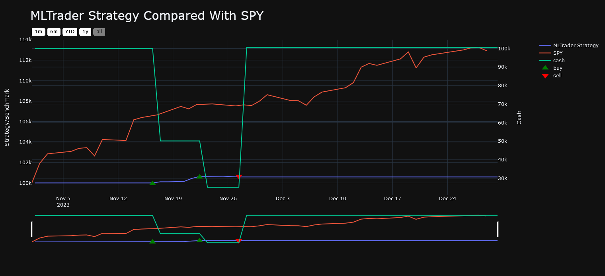

# Transformers for Stock Predictions

An AI-powered algorithmic trading and backtesting bot built with **FinBERT** (`ProsusAI/finbert`), **Lumibot**, and **Alpaca**. On each trading day, the bot fetches recent financial news headlines for a target ticker (default: `SPY`), evaluates aggregate market sentiment using a Transformer model, and executes configurable trading strategies.



## Project Structure

- `trading_bot.py` — Main `MLTrader` Lumibot strategy, Alpaca broker setup, and Yahoo Finance backtesting entrypoint.
- `sentiment_analysis.py` — Loads the `ProsusAI/finbert` Hugging Face model (on CUDA if available, otherwise CPU) to score news headlines as `positive`, `negative`, or `neutral`.
- `strategies.py` — Trading execution strategies:
  - `short_long` — Places bracket buy (+20% take-profit / -5% stop-loss) or short bracket sell (-20% take-profit / +5% stop-loss) orders on high-confidence sentiment (`> 0.999`).
  - `buy_sell` — Places market buy/sell orders based on positive or negative sentiment.
  - `one_buy` — Simple baseline bracket buy-and-hold order.
- `.env.example` — Environment variable template for Alpaca API credentials.

## Setup

1. **Create and activate a virtual environment**

   ```powershell
   python -m venv .venv
   .\.venv\Scripts\Activate.ps1
   ```

2. **Install dependencies**

   ```powershell
   pip install -r requirements.txt
   ```

   > **GPU support (optional):** Install a CUDA-enabled build of PyTorch from [pytorch.org](https://pytorch.org/get-started/locally/) for faster FinBERT inference.

3. **Configure Alpaca credentials**

   Copy `.env.example` to `.env` and fill in your [Alpaca](https://alpaca.markets/) Paper Trading API keys:

   ```powershell
   Copy-Item .env.example .env
   ```

## Usage

Run a backtest (default: `SPY` from `2020-01-01` to `2023-12-31`):

```powershell
python trading_bot.py
```

Test the FinBERT sentiment module standalone:

```powershell
python sentiment_analysis.py
```

## Disclaimer

This project is for educational and research purposes only and does not constitute financial or investment advice. Algorithmic trading carries significant risk.
